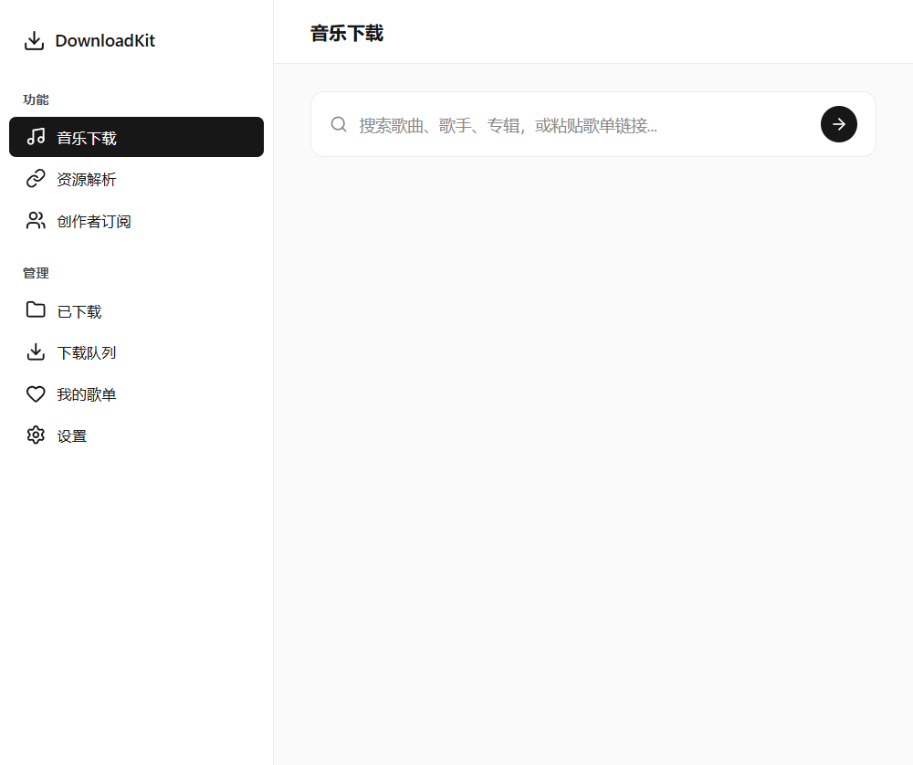
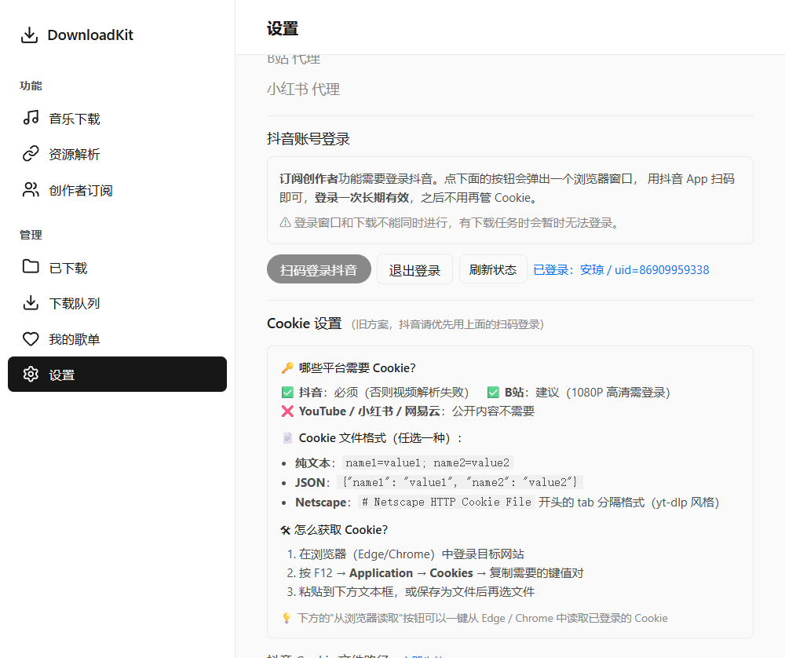
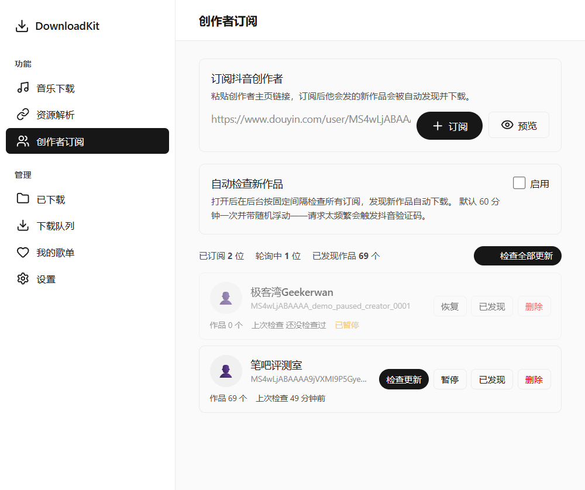
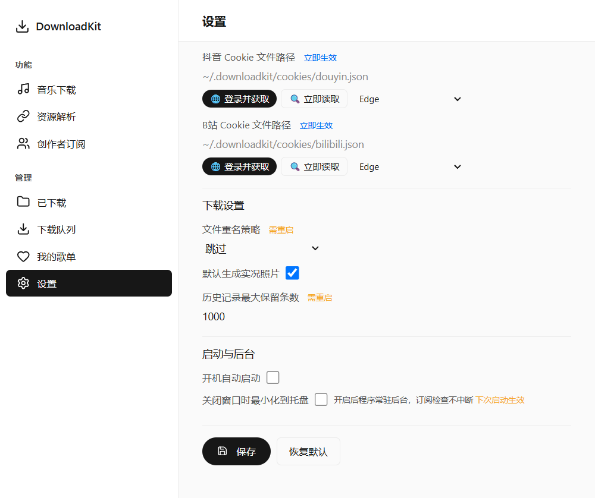

# DownloadKit 使用说明（新手版）

写给完全不懂技术的人。

**你只需要双击一个文件**，不用装 Python、不用敲命令、不用配环境。
整个过程就是：启动 → 扫一次码 → 粘一个链接 → 等它自己下载。

---

## 一、开始之前

需要准备：

1. 一台 Windows 电脑
2. 手机上装着**抖音 App**（要用它扫码登录）
3. 一个 `downloadkit.exe` 文件

> 这是一个绿色软件，**不用安装**。放在哪都能运行，删掉文件夹就等于卸载。

---

## 二、第 1 步：双击启动

双击 `downloadkit.exe`，等几秒钟，会弹出一个窗口：



左侧是功能菜单，右侧是当前功能的内容。**先不用管它**，往下看。

**第一次打开会稍慢一点**——程序在解压自己，属于正常现象，耐心等十几秒。

### 如果双击打不开

按顺序试：

| 现象 | 怎么办 |
|------|--------|
| 什么都不发生 | 等 30 秒。第一次启动比较慢 |
| Windows 蓝色提示"已保护你的电脑" | 点 **「更多信息」→「仍要运行」** |
| 杀毒软件拦截 | 在杀毒软件里选**「信任」或「允许」** |
| 一闪而过就没了 | 把 exe 放到**桌面**再试，别放在中文路径特别深的地方 |

---

## 三、第 2 步：扫码登录抖音（只需做一次）

**「创作者订阅」这个功能必须先登录抖音**，不然看不到作者的作品列表。

1. 点左侧菜单的 **「设置」**
2. 往下滚动，找到 **「抖音账号登录」**
3. 点 **「扫码登录抖音」** 按钮
4. 这时会**弹出一个浏览器窗口**
5. 拿出手机，打开抖音 App **扫窗口里的二维码**
6. 手机上确认登录
7. 回到程序窗口，看到 **「已登录」** 就成功了



> ✅ **登录一次，长期有效**。登录状态保存在本地，以后开机不用再扫。
> 要换账号就点 **「退出登录」**，再重新扫。

> ⚠️ **登录窗口和下载不能同时进行**——有下载任务在跑的时候会暂时无法登录。
> 遇到提示，等下载完再扫就行。

---

## 四、第 3 步：订阅创作者

登录成功后，点左侧 **「创作者订阅」**：



### 怎么拿到作者主页链接

在抖音 App 里：

1. 打开你想关注的作者主页
2. 点右上角 **「分享」**（或者三个点）
3. 点 **「复制链接」**
4. 把链接粘贴到上面那个输入框里
5. 点 **「订阅」**

> 也可以先点 **「预览」**，看看能不能正常读到这个作者，再决定要不要订阅。

### ⚠️ 重要：第一次订阅不会补下他以前的视频

订阅之后**第一次检查，只会记住"从现在开始"这个起点**，之前发的视频**不会**下载。

这是**故意设计**的：

- 一个发了 500 个视频的作者，你要的是"**他以后发什么**"
- 把 500 个全下下来又慢又占空间，还很容易触发抖音的验证码

所以：**订阅后，等他发新视频，新视频才会被自动下载。**

### 订阅列表里的几个词

| 你看到的 | 意思 |
|---------|------|
| 已订阅 | 这个作者正在被监控 |
| 已暂停 | 暂时不检查他（点 **「恢复」** 继续） |
| 作品 69 个 | 已经发现他有 69 个作品（不等于下载了 69 个） |
| 上次检查 49 分钟前 | 上一次是什么时候看的他的主页 |

---

## 五、第 4 步：让它自动检查

### 方法一：手动点（推荐先用这个）

在「创作者订阅」页面右上角点 **「检查全部更新」**，
程序会去看每个作者有没有发新东西，有就下载。

### 方法二：全自动（长期使用开这个）

在同一个页面，找到 **「自动检查新作品」**，勾上右边的 **「启用」**，然后点下方 **「保存」**。

- **默认 60 分钟检查一次**，还会带随机浮动
- 为什么不是每隔几秒查一次：**查太频繁会触发抖音验证码**，反而用不了
- 打开后程序在后台自己跑，你不用管

### 想调整检查频率？

勾上 **「启用」** 之后，这块会**展开两个下拉框**（就在同一个卡片里，不用换页面）：

| 选项 | 能选什么 | 默认 |
|------|---------|------|
| 检查间隔 | 15 / 30 / 60 分钟，2 / 6 / 12 / 24 小时 | 60 分钟 |
| 单轮最多下载 | 1 / 3 / 5 个 | 3 个 |

> 没把握就**保持默认**。改得太激进容易触发抖音验证码，
> 那样反而什么都下不了。

---

## 六、下载的文件在哪

默认在你的**用户下载文件夹里的 DownloadKit 总文件夹**：

```
C:\Users\你的用户名\Downloads\DownloadKit
```

所有文件都收在这一个总文件夹里，**不会直接散落在 Downloads 下面**。里面按类型分好了：

| 文件夹 | 放什么 |
|--------|--------|
| `DownloadKit\music` | 音乐（MP3，带歌名/歌手标签） |
| `DownloadKit\videos` | 视频 |
| `DownloadKit\images` | 图片 |
| `DownloadKit\animated` | 实况照片 |

> **从旧版本升级上来的话**：程序第一次启动会自动把 `Downloads\music`、
> `Downloads\videos` 里已有的文件搬进总文件夹，并删掉搬空的旧文件夹。
> 同名文件不会被覆盖（会改成 `xxx (1)`）；某个文件被占用没搬动的，
> 会留在原地，下次启动再试。

**想换地方**：「设置」→「下载目录」→ 改总目录（下面没单独自定义过的分类目录会跟着一起改）→ 改完点「保存」。

---

## 七、开机启动 + 关闭到后台

在 **「设置」→ 最下面的「启动与后台」**：



### 开机自动启动

勾上 **「开机自动启动」**，以后**开机就自动打开**这个程序，不用你再双击。

> 这个开关**只在使用 exe 时可用**（源码运行时是灰的，属正常）。
> 勾完**立即生效**，不用点保存。

### 关闭窗口时最小化到托盘

勾上这个再点「保存」，以后**点窗口右上角的 ✕ 不会退出程序**，
而是**收进右下角的托盘区**继续在后台跑——**订阅检查不会中断**。

- **双击托盘图标**：把主窗口叫回来
- **想彻底退出**：右键托盘图标 → **「退出」**

> ⚠️ 这一项**下次启动生效**（本次启动的设置不改当前行为）。
> 不勾它的话，点 ✕ 就是直接退出——和以前一样。

---

## 八、下载音乐

点左侧 **「音乐下载」**，在搜索框里：

- **输入歌名 / 歌手名** 回车搜索，然后点结果右边的下载按钮
- 或者**直接粘贴一个歌单链接**（网易云、QQ 音乐），点右边的箭头

下载完的音乐在 `Downloads\DownloadKit\music` 里，文件名、歌手、专辑信息都写好了。

---

## 九、常见问题

### Q：双击没反应？

按第 2 步的表格从上往下试一遍。最常见的原因是**杀毒软件拦截**。

### Q：提示「登录已失效，请重新扫码」

抖音的登录态过期了。去 **「设置」→「扫码登录抖音」** 重新扫一次就行。

### Q：订阅了但一直没下载到新视频？

按顺序检查 4 件事：

1. **登录还有效吗**？（设置 → 看是不是「已登录」）
2. **自动检查启用了吗**？（创作者订阅 → 「启用」勾了没，勾了要点保存）
3. **他最近真的发新视频了吗**？可以手动点「检查全部更新」试一次
4. **是不是刚订阅**？第一次只记起点，不会补下以前的（见第四节）

### Q：怎么彻底退出程序？

- 没开「关闭到托盘」：直接点窗口的 **✕** 就退出了
- 开了「关闭到托盘」：**右键右下角托盘图标 → 「退出」**

### Q：能不能把他以前的视频也下下来？

目前**不提供**"一键下完全部"，这是刻意的（见第四节的说明），
避免又慢又占空间还触发验证码。

### Q：会占很多空间吗？

分清楚三种动作，它们**下载行为不一样**：

| 动作 | 下载文件吗 |
|------|-----------|
| **订阅**一个作者、点**预览** | ❌ 不下载，只是读一下他的主页 |
| **「检查全部更新」** / 自动检查 | ⭕ **发现新作品才下载**；没有新作品就什么都不下 |
| 搜索结果里点**下载按钮** | ✅ 下载你点的那一首/那一个 |

另外：**已经下载过的不会重复下**，同一个视频不会占两份空间。

---

## 十、一张图记住整个流程

```
双击 downloadkit.exe
      ↓
设置 → 扫码登录抖音（只做一次）
      ↓
创作者订阅 → 粘贴作者主页链接 → 订阅
      ↓
勾「自动检查新作品 → 启用」→ 保存
      ↓
   挂着不管
      ↓
他一发新视频 → 自动下载到 Downloads\DownloadKit\videos
```
